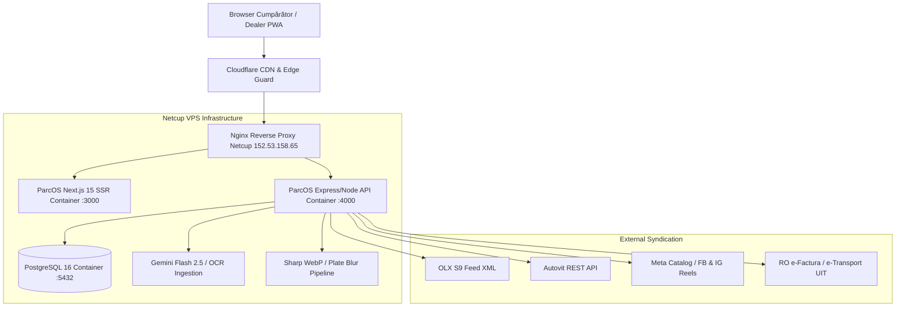

# SPECIFICAȚIE TEHNICĂ & PLAN DE BĂTĂLIE: PARCOS VS CARMATIK
> **Document:** `FEATURE_TEARDOWN_SPEC.md`  
> **Brand & Asset-uri:** ParcOS (`parcos.ro`, `parcos.app`, `getparcos.com`)  
> **Hosting VPS:** Netcup VPS (`152.53.158.65`) — containere `parcos-web`, `parcos-api`, `parcos-db`  
> **Invariante:** Strict 21% TVA (`VAT_RATE = 0.21`), Terminologie „Cont de Garanție”, Dark Luxury Dual-Theme

---

## 1. MATRICEA DE PARITATE & SUPERIORITATE: PARCOS VS CARMATIK

| Modul / Funcționalitate | Carmatik (`dealer.carmatik.ro`) | ParcOS (`parcos.ro` / `parcos.app`) | Avantaj Strategic ParcOS |
| :--- | :--- | :--- | :--- |
| **Arhitectură Frontend** | Monolit Java Spring Boot + SSR (Thymeleaf/JSP) + Bootstrap 4 | Next.js 15 App Router + React 19 + Tailwind CSS + Lucide Icons | Interfață SPA ultra-rapidă, tranziții fluide, offline-first PWA |
| **Viteza de Încărcare (LCP)** | 2.3s – 14.1s (Lighthouse 32–64/100) | **< 0.8s** (Lighthouse 95–100/100) | SEO superior pentru dealer și experiență fără latență pentru cumpărători |
| **Estetică & Temă** | Temă deschisă învechită (Bootstrap 2018, gri/alb tern) | **Dark Luxury Dual-Theme** (Jet Black `#09090b` / Slate adaptiv) | Poziționare premium, impact vizual puternic („WOW factor”) la demo-uri |
| **Scanare OCR Documente** | Desktop-mobil prin cod QR (necesită 2 dispozitive) | **Scanare Directă în Cameră PWA** (Tesseract / Gemini Flash Vision) | Dealerul scanează actele direct pe teren sau în mașină, fără desktop |
| **Tipuri de Dosare** | Achiziție, Consignație, Buy-back, Consignație internă | **Identic + Dosar Licitat / Import Broker** | Suport nativ pentru importuri și parteneriate holding AutoLicit |
| **Optimizare Imagini & Media** | Imagini brute, necomprimate, încărcare lentă | **Sharp / WebP + Blurhash + Eliminare automată numere (YOLO)** | Protecție date personale și încărcare instantanee pe mobil |
| **Studio Media & Video AI** | Doar text șablon Facebook fix | **Video Reels 9:16 (Grok/Seedance) + Voce Română (ElevenLabs)** | Social media complet automatizat la standard de agenție de marketing |
| **Sincronizare Marketplace** | Autovit (doar pachet scump), OLX, Facebook | **OLX S9 Feed + Autovit REST + Facebook/TikTok Catalog** | Conectori flexibili fără a forța dealerul la pachete prohibitive |
| **Modul Financiar & TVA** | Opțiuni mixte | **Strict 21% TVA deductibil + Regim Marjă de Profit** | Conformitate contabilă strictă și fără ambiguități |
| **Garanții & Rezervări** | Lipsește modulul dedicat de escrow/garanție | **Cont de Garanție Integrat** (Banca Transilvania / Netopia) | Încredere maximă pentru cumpărători la rezervarea mașinii |
| **Model Comercial / Preț** | 150 – 500 €/lună (opac, bazat pe negocieri) | **Modular / Transparent:** Tier Starter (49€) / Pro (149€) / Enterprise | Preț imbatabil cu marjă brută excelentă pe Netcup VPS |

---

## 2. ARHITECTURA TEHNICĂ PARCOS

---

## 3. STRUCTURA MODULELOR PARCOS (DIRECT FEATURE PARITY)

### 3.1. Modulul 1: Scanerul Inteligent de Documente (ParcOS OCR)
- **Implementare:** Folosirea `src/services/civScanner.ts` și `src/services/talonScanner.ts` cu fallback pe `gemini-2.5-flash` pentru decodare structurală în sub 2 secunde.
- **Formate Acceptate:**
  1. Carte de Identitate Vehicul (CIV România - 17 caractere VIN, număr omologare, cilindree, putere kW/CP, normă poluare).
  2. Certificat Înmatriculare (Talon Auto - data primei înmatriculări, serie șasiu, utilizator).
  3. Carte de Identitate Românească (CI Vânzător/Cumpărător pentru contract).
- **Avantaj ParcOS:** Utilizatorul apasă „Scanează” direct de pe telefon din PWA, camera decupează automat marginile și populează câmpurile din dosar în timp real.

### 3.2. Modulul 2: Wizard-ul de Înregistrare Mașină (6 Pași)
Se preia structura validată a Carmatik, optimizată pentru UX fluid:
1. **Pas 1 — Dosar Proiect:**
   - Tip dosar: `ACHIZITIE_PROPRIE`, `CONSIGNATIE`, `BUY_BACK`, `IMPORT_LA_COMANDA`.
   - Locație parc / punct de lucru (ex: Showroom Cluj, Showroom București).
   - Agent responsabil (asociat din echipa dealerului).
2. **Pas 2 — Date Tehnice Mașină:**
   - VIN decodare instantă (Marcă, Model, An, Motorizare, Combustibil, Cutie, Transmisie, Caroserie, Kilometraj).
3. **Pas 3 — Furnizor / Partener:**
   - Căutare automată CUI ANAF pentru persoane juridice (populare automată denumire, adresă, IBAN, dacă este plătitor de TVA).
   - Validare CNP pentru persoane fizice.
4. **Pas 4 — Recepție & Inspecție Tehnică:**
   - Checklist digital: Stare caroserie, anvelope (profil mm), număr chei, istoric service, raport carVertical / Cebia atașat în PDF.
5. **Pas 5 — Financiar & Preț Vânzare:**
   - Preț achiziție net.
   - Costuri logistice (transport intracomunitar, detailing, schimb ulei/filtre).
   - Calcul TVA (Strict 21% la valoarea totală sau la marja de profit).
   - Preț de vânzare final afișat (cu TVA inclus).
6. **Pas 6 — Contract & Publicare:**
   - Generare instantă contract intrare în stoc / consignație în PDF cu semnătură pe ecran.
   - Trimitere automată pe site-ul dealerului și în feed-urile de marketplace.

### 3.3. Modulul 3: Sincronizare Multi-Canal (OLX S9 & Autovit)
- **OLX S9 XML Feed:** Generare automată a feed-ului XML conform standardului OLX S9 pentru categorii auto (`/api/feed/olx.xml`), cu reîmprospătare la fiecare 30 de minute.
- **Autovit REST:** Integrare OAuth2 cu endpoints de stoc (`/api/stock/autovit`).
- **Social Media:** Generare descrieri persuasive și export pachete foto cu watermark subtil al parcului auto.

### 3.4. Modulul 4: Modul Financiar, Leasing & Garanții
- **Simulator de Leasing & Credit:**
  - Calcul avans (15% - 50%), durată (12 - 60 luni), rată lunară estimată în EUR și RON.
  - Generare fișă de simulare în format PDF personalizată cu logo-ul dealerului.
- **Cont de Garanție (Rezervare Mașină):**
  - Cumpărătorul poate bloca o mașină plătind o garanție de rezervare (ex: 500 € / 2.500 lei) prin card bancar.
  - Suma este reținută în **Contul de Garanție** până la finalizarea tranzacției sau vizionarea mașinii în parc.

---

## 4. PLAN DE ACȚIUNE PENTRU WORKSPACE-UL LOCAL (`rxm-automobile`)

Pentru a putea demonstra soluția oricărui dealer fără a fi menționat RXM Automobile, efectuăm următoarele două modificări structurale în cod:

1. **Adăugare Mock Dealer Seed (`SEED_PARCOS_DEMO`):**
   - În `src/db/dealer.ts` / contextul de stoc, definim un dealer neutru:
     - Denumire: **„Autoparc Elite Motors”**
     - Slogan: **„Parc Auto Rulate Verificate & Garanție”**
     - CUI: `RO38912401`, Oraș: `Cluj-Napoca`, Telefon: `0722 000 111`
     - Fără mențiuni de RXM sau Automobile RXM.
2. **Componentă Universală de Branding (`<BrandEmblem />`):**
   - Modificăm `Navbar.tsx` și `Footer.tsx` pentru a prelua numele, logo-ul și contactul dinamic din setările dealerului conectat, permițând comutarea cu un singur parametru (`?demo=parcos`) între modul RXM și modul White Label ParcOS.

---

## 5. REZUMAT LIVRABILE AUDIT

1. **`audit-baseline/baseline-spec.json`** — Specificația tehnică de date a tuturor rutelor și câmpurilor Carmatik.
2. **`audit-baseline/BASELINE_REPORT.md`** — Raportul complet de audit al competitorului, cu capturi de ecran și analiza slăbiciunilor.
3. **`audit-baseline/FEATURE_TEARDOWN_SPEC.md`** — Planul de luptă și specificația de implementare pentru ParcOS.
4. **Oglindire Google Drive:** Toate fișierele și cele 13 screenshots au fost sincronizate în folderul dedicat:  
   `I:\My Drive\CARVANA_SRL\08_PROJECT_PARCOS\03_Cercetare_Piata_si_Competitori\carmatik_baseline\`
