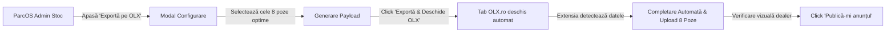

# GHID OPERAȚIONAL: Publicare Automată pe OLX România din ParcOS
> **Data:** 2026-10-23  
> **Modul:** ParcOS OLX Auto-Poster Suite  
> **Target:** Dealeri Auto Parteneri CARVANA SRL & RXM Automobile  

---

## 1. Prezentare Generală

Modulul **ParcOS OLX Auto-Poster** permite parcurilor auto partenere să transfere instant orice autoturism din showroom-ul ParcOS direct în formularul de adăugare anunț al **OLX România (`olx.ro/adding/`)**.

### De ce această abordare este superioară?
- **Zero Costuri API:** Nu necesită pachete enterprise scumpe sau integrări API restrictate de OLX.
- **Zero Risc de Blocare / CAPTCHA:** Publicarea se execută local în browserul dealerului, beneficiind de sesiunea deja autentificată și rezolvarea naturală a 2FA prin SMS.
- **Respectare Strictă a Politicii OLX:** OLX permite maxim **8 fotografii per anunț** — ParcOS filtrează inteligent cele mai bune 8 cadre comerciale din cele 20-30 de fotografii din showroom.
- **Control Total al Dealerului:** Formularul este completat în întregime, dar butonul final `[Publică-mi anunțul]` este lăsat pentru confirmarea dealerului, prevenind consumul neintenționat de credite OLX.

---

## 2. Metoda Recomandată: Extensia Chrome ParcOS (1 minut)

Extensia se află în folderul local `extensions/parcos-olx-publisher/`.

### Pași de Instalare în Google Chrome / Brave / Edge:
1. Deschide Google Chrome și tastează în bara de adrese: `chrome://extensions/`
2. În colțul din dreapta sus, activează comutatorul **„Developer mode”** (Mod dezvoltator).
3. În colțul din stânga sus, apasă pe butonul **„Load unpacked”** (Încarcă extensie dezarhivată).
4. Selectează folderul:
   ```
   C:\Projects\parcos\extensions\parcos-olx-publisher
   ```
5. Extensia va apărea în bara de instrumente cu numele **ParcOS OLX Publisher**. Gata!

---

## 3. Metoda Alternativă: Smart Bookmarklet (Zero Instalare)

Pentru calculatoarele de serviciu unde dealerii nu au permisiuni de administrator sau nu doresc extensii:
1. În ParcOS Admin, deschide fereastra de export apăsând pe **`[Exportă pe OLX]`**.
2. Mergi la tabul **„Bookmarklet 1-Click”**.
3. Trage cu mouse-ul butonul galben **`⚡ ParcOS OLX Auto-Poster`** direct în bara de semne de carte (Bookmarks Bar) din Chrome.
   *(Dacă nu vezi bara de sus, apasă `Ctrl + Shift + B`)*.
4. Când ești pe pagina `olx.ro/adding/`, apasă o singură dată pe acest marcaj din bară, iar mașina se va completa instant!

---

## 4. Fluxul de Lucru Pas-cu-Pas pentru Dealer



### Pasul 1: Selectarea mașinii în ParcOS Admin
- În panoul de gestiune stoc, pe orice rând sau card de mașină, apasă pe meniul de acțiuni (trei puncte) și alege **`🚀 Exportă pe OLX`**.

### Pasul 2: Verificarea parametrilor în modal
- **Fotografii (8 poze):** Sistemul alege automat cele 8 cadre esențiale (Față, Spate, Lateral, Bord, Scaune, Consolă, Jante, Detaliu). Poți schimba oricare poză dând click pe ea.
- **Preț & Monedă:** Poți comuta între `€ (EUR)` sau `lei`.
- **Serie Șasiu (VIN):** Poți bifa dacă vrei ca seria să apară public pe OLX sau să fie ascunsă.
- **Autoprelungire:** Este dezactivată implicit (`false`), pentru a nu genera costuri neprevăzute pe contul tău OLX.
- **Descriere Comercială:** Generată automat cu garanție 12 luni, finanțare rate prin TBI Bank, BT Direct și UniCredit, opțiune Buy-Back și Cont de Garanție.

### Pasul 3: Lansarea
- Apasă butonul mare **`🚀 Exportă & Deschide OLX`**.
- Se va deschide automat pagina oficială de adăugare anunț de pe OLX.

### Pasul 4: Completarea Automată pe OLX
- Extensia injectează automat:
  1. **Titlul** și selectează categoria corectă `Auto -> Autoturisme`.
  2. **Prețul** și bifa de negociabil / monedă.
  3. **Parametrii tehnici:** Kilometraj, An, Capacitate cilindrică, Putere, Cutie automată/manuală, Caroserie, Culoare, Combustibil.
  4. **Descrierea completă** comercială.
  5. **Datele de contact** ale parcului tău (persoană, telefon, localitate).
  6. **Cele 8 fotografii** alese sunt descărcate și încărcate direct pe serverele OLX.
- În colțul din dreapta jos apare badge-ul verde:  
  **`✅ Toate câmpurile au fost completate! Te rugăm să arunci o privire peste date și să apeși butonul [Publică-mi anunțul].`**

---

## 5. Invariante de Conformitate CARVANA SRL

1. **21% TVA:** Dacă mașina are TVA deductibil, descrierea precizează expres `TVA deductibil 21% inclus pe factură fiscală`.
2. **Cont de Garanție:** Tranzacțiile securizate sunt prezentate sub denumirea strictă de **„Cont de Garanție”** (niciodată termeni nepotriviți precum „escrow”).
3. **Imagini Curate:** Dacă parcul auto folosește modulul ParcOS Watermark sau Plate Studio, numerele de înmatriculare sunt deja acoperite profesional cu plăcuța personalizată a dealerului înainte de trimiterea pe OLX.
