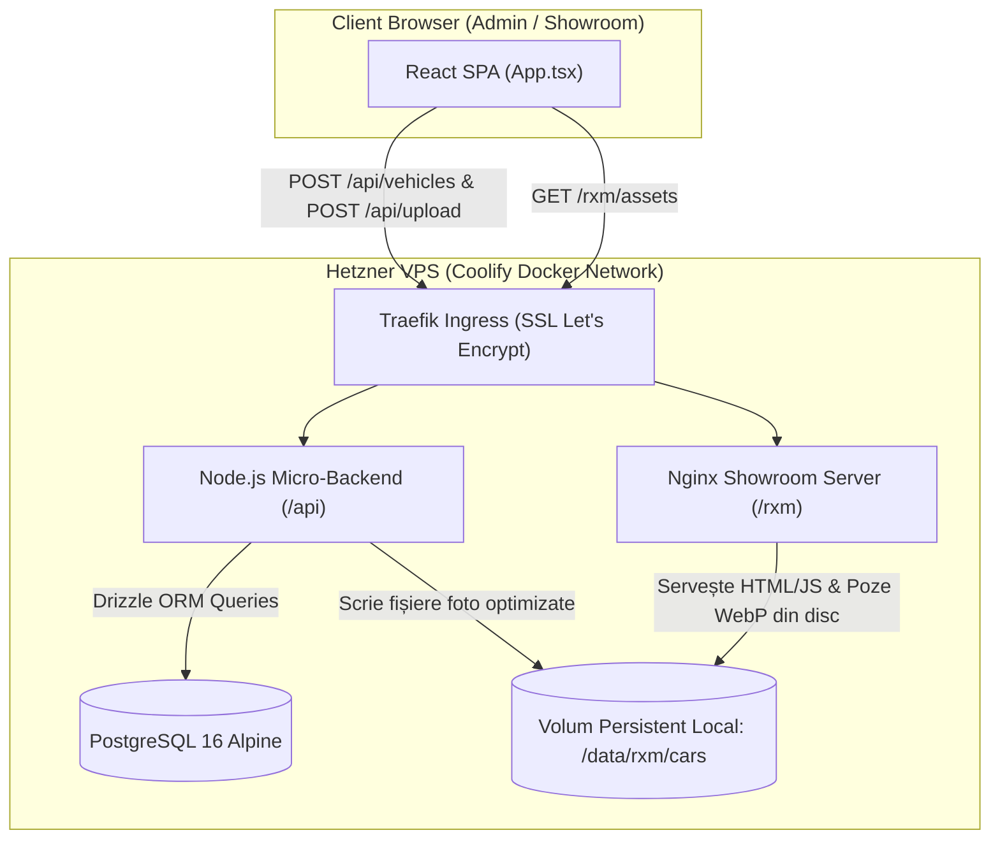

# 🏗️ Analiză Tehnică & Arhitectură Bază de Date: VPS Coolify vs. Supabase Cloud pentru RXM Automobile
> **Data & Ora:** 2026-10-17 23:28:00  
> **Holding:** CARVANA SRL  
> **Target:** RXM Automobile & Showroom Replicabil  
> **Infrastructură Activă:** Hetzner Cloud VPS (Coolify Orchestrator, Traefik Reverse Proxy, Nginx)

---

## 1. Problema Arhitecturală Fondatoare

În prezent, RXM Automobile funcționează ca un **Single Page Application (SPA) React** compilat și servit prin Nginx pe VPS (`autolit.ro/rxm`).
- Când un administrator adaugă o mașină nouă prin Panoul de Admin, datele ajung în `localStorage`, iar pozele mari ajung în `IndexedDB` (`mediaVaultDb.ts`).
- **Problema:** Un browser client (Chrome pe laptopul dealerului) **NU se poate conecta direct pe protocol TCP brut (port 5432) la PostgreSQL**. Browserul este limitat de sandbox-ul web strict la apeluri HTTP (REST / GraphQL) și WebSockets.
- Prin urmare, pentru ca mașina să fie publicată **Live pentru toți clienții din internet** prin apăsarea butonului „🚀 Publică Instant în Showroom”, este obligatoriu un strat API intermediar care să primească cererile HTTP din browser și să le scrie într-o bază de date persistentă.

---

## 2. Matricea Comparativă a Opțiunilor de Arhitectură

| Criteriu | Opțiunea A: Node/Express Micro-API + Drizzle ORM (VPS Coolify) | Opțiunea B: PostgreSQL + PostgREST (VPS Coolify) | Opțiunea C: PocketBase (VPS Coolify) | Opțiunea D: Supabase Cloud Managed |
|---|---|---|---|---|
| **Unde stau datele?** | 100% pe VPS Hetzner (Docker) | 100% pe VPS Hetzner (Docker) | 100% pe VPS Hetzner (Docker) | Supabase Cloud (AWS Frankfurt) |
| **Unde stau pozele?** | Volum pe disc VPS (`/data/rxm-showroom/cars`) | Volum pe disc VPS (necesită micro-uploader) | Integrat nativ în PocketBase storage | Supabase Storage CDN (Bucket `cars`) |
| **Complexitate Instalare** | Medie (Container Node + Container PG în Compose) | Medie-Scăzută (Compose cu 2 imagini oficiale) | Ultra-Simplă (1 singur container de 15MB) | Zero pe VPS (se rulează SQL în cloud) |
| **Consum Resurse VPS** | ~60MB RAM (Node) + ~40MB RAM (PG) | ~20MB RAM (PostgREST) + ~40MB RAM (PG) | ~15MB RAM total | 0 MB RAM pe VPS |
| **Costuri Lunare** | 0€ (inclus în chiria VPS Hetzner existent) | 0€ (inclus în VPS) | 0€ (inclus în VPS) | 0€ (Free Tier) sau 25$/lună (Pro) |
| **Stare Cod Curent** | Drizzle ORM deja instalat (`src/db/schema.ts`) | Necesită endpoint upload media | Necesită adaptare client REST | 80% gata (`supabaseClient.ts`, `cloudMediaStorage.ts`) |
| **Risc de Deconectare/Sleep** | ZERO (rulează non-stop în Docker) | ZERO (rulează non-stop în Docker) | ZERO (rulează non-stop în Docker) | Risc de pauză la 7 zile fără trafic (Free tier) |
| **Independență Holding** | 100% Suveranitate (Zero Vendor Lock-in) | 100% Suveranitate | 100% Suveranitate | Dependent de platforma Supabase |

---

## 3. Detalierea Celor Mai Bune Două Opțiuni

### 🥇 Opțiunea 1: Auto-Găzduit pe VPS Coolify (Micro-API Node + Drizzle ORM + Stocare Nginx)
**Cea mai curată pentru viziunea CARVANA SRL pe termen lung (Suveranitate Totală pe VPS)**



- **Cum funcționează:**
  1. În `infra/docker-compose.yml` adăugăm un container PostgreSQL mic și un serviciu Node.js simplu (care folosește schema Drizzle deja existentă în [`src/db/schema.ts`](file:///c:/Projects/rxm-automobile/src/db/schema.ts)).
  2. Când dealerul încarcă poze de pe telefon sau desktop, API-ul le salvează direct pe discul VPS-ului în `/data/rxm-showroom/cars/...`.
  3. Nginx le servește instantaneu către toți vizitatorii cu cache de 1 an (`Cache-Control: public`) și viteză de gigabit.
- **Avantaj uriaș:** Fără limite de spațiu externe, fără dependență de API keys care pot expira, fără costuri per cerere.

---

### 🥈 Opțiunea 2: Supabase Cloud Managed (Soluția Imediată „Turnkey”)
**Cea mai rapidă de pornit în această seară (Zero modificări de infrastructură VPS)**

- **Cum funcționează:**
  1. Proiectul are deja tot codul scris:
     - [`src/lib/supabaseClient.ts`](file:///c:/Projects/rxm-automobile/src/lib/supabaseClient.ts) — verifică și creează conexiunea.
     - [`src/services/cloudMediaStorage.ts`](file:///c:/Projects/rxm-automobile/src/services/cloudMediaStorage.ts) — încarcă pozele direct în bucket-ul `cars`.
     - [`src/services/vehicleRepository.ts`](file:///c:/Projects/rxm-automobile/src/services/vehicleRepository.ts) — citește și scrie mașinile cu SWR cache.
     - [`scripts/supabase_schema.sql`](file:///c:/Projects/rxm-automobile/scripts/supabase_schema.sql) — schema DDL gata pregătită cu RLS și indexuri.
  2. Tot ce trebuie este crearea unui proiect gratuit pe Supabase și adăugarea celor două linii în fișierul `.env`:
     ```env
     VITE_SUPABASE_URL=https://xyzcompany.supabase.co
     VITE_SUPABASE_ANON_KEY=eyJhbGciOi...
     ```
- **Avantaj:** Mașinile devin Live în 5 minute fără a restarta sau reconfigura Docker pe VPS.
- **Dezavantaj:** Dacă parcul auto depășește 1GB de poze pe tier-ul gratuit sau dacă proiectul nu are activitate timp de 7 zile, Supabase îl poate pune în pauză.

---

## 4. Recomandarea Strategică CARVANA SRL

1. **Pe termen lung:** Varianta **Bază de Date direct pe VPS prin Coolify (Opțiunea 1)** este **cea mai sănătoasă**, sigură și profesională. Se integrează perfect în infrastructura existentă, elimină intermediarii și folosește resursele deja plătite pe Hetzner.
2. **Calea de Tranziție Recomandată:**
   - Putem pregăti **Micro-API-ul Node cu PostgreSQL în `infra/docker-compose.yml`**, refolosind schema Drizzle existentă.
   - Astfel, `vehicleRepository.ts` va face un simplu `fetch('/api/vehicles')` pe același domeniu (`autolit.ro/rxm/api/vehicles`), iar pozele se vor uploada la `/api/upload` direct pe hard disk-ul serverului.
   - Rezultat: 100% control, zero chei secrete expuse, viteză maximă!
