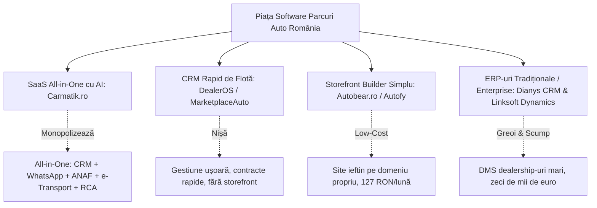

# 🔬 RAPORT CERCETARE COMPETITORI: CARMATIK.RO & ECO SISTEMUL CRM/STOREFRONT AUTO (ROMÂNIA 2026)
> **Data & Ora:** 2026-10-18 22:05:00  
> **Sursă Grounding:** NotebookLM Master Brain (`[CARVANA] RXM Automobile Showroom Brain` • `86c800a6-9429-46c4-a9a9-894d205df501`)  
> **Target:** Arhitectură Comercială & Tehnologică „Carvana Dealer OS” (Holding CARVANA SRL)

---

## 🧭 1. REZUMAT EXECUTIV: CINE SUNT ȘI CE FOLOSESC COMPETITORII?

Pe piața din România există 4 categorii clare de competitori care încearcă să rezolve problema parcurilor auto:

---

## 📊 2. ANALIZĂ COMPARATIVĂ DETALIATĂ PE FIECARE COMPETITOR

### 🥇 A. CARMATIK.RO (Liderul Pieței SaaS Auto din România)
* **Companie & Fondator:** CARMATIK S.R.L. (fondată în dec. 2022, București), cofondator **Maxim Helmi**.
* **Ce este:** O platformă integrată B2B (CRM & Gestiune Stoc) combinată cu un Marketplace B2C și aplicație mobilă dedicată în Google Play / App Store.
* **Stack Tehnologic Utilizat:**
  * **Backend:** Java 17 (Spring Boot, Spring Security, microservicii).
  * **Cloud & Infra:** AWS (EC2, S3 pentru găzduire foto mașini, Route 53, Jenkins CI/CD, containere Docker).
  * **Frontend:** React / React Native (pentru aplicația mobilă), Bootstrap, jQuery pe unele module legacy, PostCSS.
  * **Integrări Terțe:** Meta Tech Provider (acces oficial la WhatsApp Business Cloud API), Netopia Payments (pentru procesare plăți card), parteneriat Cebia (istoric daune), parteneriat Otto Broker (cedare comision din polițe RCA/CASCO către dealer), e-Factura / e-Transport SPV ANAF.
* **Propunere de Valoare:** Asistentul digital „Matik” — promovat ca un super-angajat digital 24/7 care preia lead-urile, citește actele prin poză, publică pe Autovit/Meta și ține contabilitatea primară.
* **Puncte Forte:**
  * Sincronizare multi-channel (Autovit, mobile.de, Facebook/Instagram).
  * Automatizare fiscală românească completă (e-Factura, e-Transport, calcul marjă profit Art. 312).
  * Monetizare post-vânzare prin asigurări RCA/CASCO.
* **Puncte Slabe:**
  * **Site-ul de dealer oferit este șablonat și generic:** Nu are aspect de showroom de lux („Carvana/AutoScout24 style”), ci arată ca un catalog web standard din 2018-2020.
  * **Vendor Lock-in masiv:** Toate datele dealerului sunt găzduite în cloud-ul lor comun. Dacă dealerul pleacă, pierde tot istoricul și conexiunea.
  * **Fără libertate de brand:** Dealerul este împins să apară în aplicația comună Carmatik, unde cumpărătorul vede și mașinile parcurilor concurente.

---

### 🥈 B. DEALEROS (de la MarketplaceAuto.ro)
* **Ce este:** Un CRM auto simplu și agil pentru parcuri mici și medii.
* **Stack Tehnologic:** SaaS Cloud PHP/Node.js, baze de date relaționale, layout-uri ușoare tip dashboard administrativ.
* **Propunere de Valoare:** „Tot ce ai nevoie, nimic în plus” — configurare în 5 minute, generare de contracte de vânzare-cumpărare în sub 30 de secunde și gestiunea alertelor de flotă (RCA, ITP, numere roșii expirate).
* **Puncte Forte:** Foarte ușor de învățat pentru angajații mai puțin tehnici, interfață curată.
* **Puncte Slabe:**
  * **NU oferă site/storefront public:** Este strict un panou intern de gestiune.
  * Fără capabilități AI, fără scanare OCR a actelor, fără sincronizare avansată cu OLX.

---

### 🥉 C. AUTOBEAR.RO (by Autofy)
* **Ce este:** Un generator de storefront-uri online pentru parcuri auto pe propriul domeniu.
* **Stack Tehnologic:** Platformă SaaS multitenant (React/Next.js).
* **Model de Preț:** Foarte agresiv și transparent: de la 127 RON / lună (până la 50 de mașini).
* **Propunere de Valoare:** Prezență web rapidă pe domeniul propriu al dealerului (`nume-parc.ro`).
* **Puncte Slabe:**
  * CRM extrem de sărac (fără generare automată de contracte complexe, fără calcul de marjă, fără e-Factura/e-Transport).
  * Agentul AI este un serviciu extern plătit separat, nu o funcționalitate integrată nativ.

---

### 🏢 D. DIANYS CRM & LINKSOFT (Soluțiile Custom & Enterprise)
* **Dianys CRM:** Dezvoltare custom pe comandă (PHP/MySQL) integrată cu ateliere mecanice, ITP și service. Dezavantaj: costuri mari de implementare și timp de lansare de săptămâni/luni.
* **Linksoft (Microsoft Dynamics 365):** Soluție enterprise pentru rețele mari (grupuri de reprezentanțe). Costuri de zeci de mii de euro, nepotrivită pentru parcurile auto independente de mașini rulate.

---

## ⚔️ 3. CUM DEPASIM ACEȘTI COMPETITORI CU CARVANA DEALER OS?

Pentru a câștiga contracte cu parcurile auto în fața Carmatik sau a altor agenții, platforma noastră oferă avantaje competitive decisive:

| Criteriu | Carmatik.ro 🥇 | Autobear.ro 🥉 | **CARVANA DEALER OS (Standardul Nostru)** 🚀 |
| :--- | :--- | :--- | :--- |
| **Estetică Storefront** | Șablon alb/negru generic | Site simplu clasic | **Dark Luxury Dual-Theme (Plus Jakarta Sans, 60FPS, Lightbox Pro AutoScout24)** |
| **Media & Video** | Doar poze statice | Doar poze statice | **Integrare TikTok/Reels în Hero, Contor Vizualizări, Pinned Carved Deal** |
| **Scanare CIV / Brief** | OCR de bază pe talon RO | Fără scanare | **Scanare OCR Multilinguală: România (CIV/Talon), Germania (Brief), Franța, Italia** |
| **Sincronizare OLX** | API direct / feed | Feed manual | **Nod Edge GSM S9 (IP Mobil Rezidențial Anti-Blocare) + Buton Reconciliere 1-Click** |
| **Studio Foto Plăcuțe & Watermark** | Necesită editare externă | Inexistent | **Motor Canvas Nativ: Aplicare plăcuță dealer, eliminare reflexii, watermark HD direct din browser** |
| **Suveranitate & Date** | Cloud comun Carmatik (Vendor lock-in) | Cloud comun Autobear | **Instanță Dedicată Autonomă (Netcup VPS 152.53.158.65), zero sharing de date cu concurența** |
| **Pitch & White-Label** | Imposibil (doar brand Carmatik) | Imposibil | **Interactive Pitch Dock: Rebranding instant în 3 secunde în fața patronului de parc** |
| **Conformitate Holding** | Variabilă | Inexistentă | **Strict 21% TVA (`VAT_RATE = 0.21`), Cont de Garanție, Art. 312 Cod Fiscal** |

---

## 🎯 4. CE TREBUIE SĂ LE SPUNEM PATRONILOR DE PARCURI AUTO LA PITCH?

Când Norbi merge la o întâlnire cu un patron de parc auto care folosește sau a auzit de Carmatik:

1. **Argumentul Suveranității & Exclusivității:**  
   > *„Carmatik vă listează mașinile în aceeași aplicație cu ceilalți 50 de dealeri din județ, iar clienții voștri văd ofertele concurenței chiar sub mașina voastră. Noi vă oferim propria voastră platformă independentă de lux, pe domeniul vostru, unde sunteți doar voi și mașinile voastre.”*

2. **Argumentul Imaginilor & TikTok:**  
   > *„Tinerii cumpărători nu mai citesc texte lungi. Pe site-ul nostru, mașina vedetă rulează video-ul filmat de voi pe TikTok sau Instagram direct în capul paginii, iar în galeria foto clientul poate da zoom la 200% pe cusătura scaunului exact ca pe Mobile.de din Germania.”*

3. **Argumentul „Stop Apelurilor Inutile” (Nodul S9):**  
   > *„Ați vândut mașina sâmbătă? Sistemul nostru conectat la telefonul dedicat din parc vă alertează imediat că anunțul e încă pornit pe OLX și vă dă buton direct să-l opriți, fără să căutați prin sute de pagini.”*

4. **Argumentul Documentelor din Străinătate:**  
   > *„Când aduceți mașini din Germania sau Franța, nu mai stați să tastați serii de șasiu de 17 caractere. Deschideți telefonul, pozați brief-ul german și platforma vă completează automat capacitatea cilindrică, puterea și anul fabricației.”*
