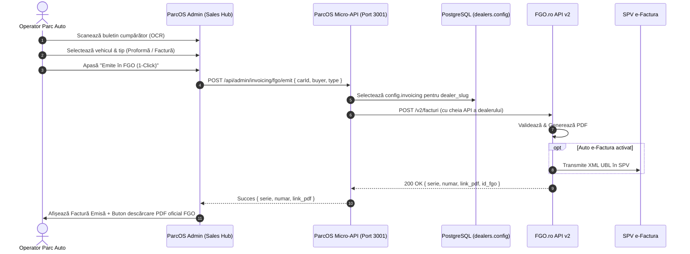

# 🧾 Specificație Tehnică & Arhitectură: Integrare FGO.ro în ParcOS
> **Data:** 22 Octombrie 2026  
> **Platform Persona:** Mao (Holding Distributed Architect & AI Pair Programmer)  
> **Target:** ParcOS (parcos.ro) & Showroom-urile Partenere (ex: RXM Automobile, MPI Auto)  
> **Invariante Holding:** Strict 21% TVA (`VAT_RATE = 0.21`), Terminologie „Garanție de Rezervare/Participare”, Multi-Tenant Bring-Your-Own-Key (BYOK)  
> **Hosting Node:** Netcup VPS (`152.53.158.65`)

---

## 1. Rezumat Executiv & Analiză de Costuri (Cum ieșim „Cel mai Ieftin / Preferabil Gratis”)

Pentru ca integrarea de facturare cu **FGO.ro** să fie **100% GRATUITĂ** pentru platforma ParcOS și **cu cost zero sau minim** pentru parcurile auto partenere, aplicăm o arhitectură hibridă inteligentă:

### A. Costul pentru Platforma ParcOS (Carvana SRL): **STRICT 0 LEI**
- ParcOS funcționează ca orchestrator SaaS de tip **BYOK (Bring Your Own Key)**.
- ParcOS **nu cumpără și nu plătește abonamente FGO** pentru parcuri. Fiecare parc auto are entitatea sa juridică distinctă (CUI, certificat digital ANAF, serie proprie).
- Apelurile API trec prin micro-routerul din `server/api.mjs` către serverele FGO, consumând sub 1 MB RAM pe VPS-ul Netcup și generând **zero costuri suplimentare de licențiere**.

### B. Costul pentru Parcurile Auto Partenere (Dealerii contractați):
1. **Tier Gratuit (0 LEI / lună) — Export 1-Click FGO & UBL e-Factura:**
   - Orice cont FGO (inclusiv pachetul gratuit) permite importul de documente din fișiere CSV / Excel / XML.
   - ParcOS generează instant fișierul gata de importat în FGO sau deschide formularul pre-populat.
   - *Start-up Perk:* Firmele noi au **12 luni gratuite** de la FGO cu e-Factura inclusă.
2. **Tier Automat (0 LEI în ParcOS, ~40 LEI/lună suportat direct de dealer către FGO):**
   - Pentru parcurile care au deja abonament FGO (GO Premium cu API activ), dealerul își introduce cheia API FGO în portalul ParcOS Admin.
   - Emiterea devine **instantanee (1-Click)** din fișa mașinii sau din ecranul de vânzări (`SalesDocumentsModal`), cu generare PDF și trimitere automată în SPV ANAF.

---

## 2. Arhitectura de Date & Configurație Multi-Tenant (Zero Migrări SQL)

Tabela `dealers` din PostgreSQL conține deja coloana `config JSONB`. Nu este nevoie de nicio migrare DDL sau downtime!

Configurația FGO per dealer se stochează în `dealers.config.invoicing`:

```json
{
  "invoicing": {
    "provider": "fgo",
    "fgo": {
      "apiKey": "eyJhbGciOiJIUzI1Ni...",
      "cui": "48482214",
      "platformUrl": "https://rxmautomobile.ro",
      "seriesFiscal": "RXM",
      "seriesProforma": "PROF",
      "defaultRegime": "margin_scheme",
      "autoSendSpv": true,
      "environment": "live"
    }
  }
}
```

---

## 3. Particularități Fiscale Auto în România (ANAF & Regimul Marjei)

Parcurile auto din România facturează în două regimuri distincte:

1. **Regimul Marjei — Bunuri Second-Hand (Art. 312 Cod Fiscal):**
   - Se aplică la majoritatea mașinilor rulate achiziționate de la persoane fizice sau fără TVA deductibil.
   - **Regulă obligatorie:** TVA-ul NU se evidențiază pe factură!
   - Cota TVA trimisă la FGO: `0` (sau Scutit fără drept de deducere).
   - Mențiune legală obligatorie pe factură:  
     `"Regimul marjei - bunuri second-hand (Art. 312 Codul Fiscal)"`.
2. **Regim Normal de TVA (21% Strict):**
   - Se aplică la vehiculele achiziționate intracomunitar sau de la persoane juridice cu TVA deductibil.
   - Cota TVA: `0.21` (strict `VAT_RATE = 0.21` conform invariantelor holdingului).
3. **Proforme / Garanție de Rezervare:**
   - Tip document FGO: `"P"` (Proformă).
   - Text linie: `"Garanție de Rezervare / Participare Autovehicul [Brand] [Model] VIN: [VIN]"`.

---

## 4. Specificare API FGO v2 (Endpoint-uri & Payload)

### Endpoint-uri Oficiale FGO:
- **UAT (Mediu de Test Gratuit):** `https://api-testuat.fgo.ro/v2/facturi`
- **Producție (Live):** `https://api.fgo.ro/v2/facturi`

### Headere Obligatorii:
```http
Authorization: Bearer {fgo_api_key}
Fgo-Cod-Unic: {cui_fara_ro}
Fgo-Url-Platforma: {platform_url}
Content-Type: application/json
```

### Exemplu Payload ParcOS ➔ FGO (Proformă Garanție Rezervare):
```json
{
  "serie": "PROF",
  "tip_factura": "P",
  "valuta": "EUR",
  "data_emitere": "2026-10-22",
  "data_scadenta": "2026-10-29",
  "id_extern": "PARCOS-RES-RXM-089",
  "verificare_duplicat": true,
  "client": {
    "tip": "PF",
    "denumire": "Popescu Mihai",
    "cod_unic": "1850412125890",
    "email": "mihai.popescu@gmail.com",
    "tara": "Romania",
    "cod_judet": "CJ",
    "localitate": "Cluj-Napoca",
    "adresa": "Str. Brâncuși nr. 45"
  },
  "articole": [
    {
      "cod_articol": "GAR-REZ-AUTO",
      "denumire": "Garanție de Rezervare autoturism BMW Seria 3 2.0d 2020 - VIN: WBA...",
      "um": "buc",
      "nr_produse": 1,
      "pret_unitar": 500,
      "cota_tva": 0.21
    }
  ],
  "observatii": "Cont de Garanție deschis la Banca Transilvania. Se deduce din prețul final."
}
```

---

## 5. Fluxul de Utilizare în Portalul ParcOS Admin



---

## 6. Etape de Implementare Tehnică

1. **Backend Proxy (`server/api.mjs`):**
   - Adăugare rută `/api/admin/invoicing/fgo/emit` securizată cu sesiune admin.
   - Endpoint de test conexiune `/api/admin/invoicing/fgo/test-connection`.
2. **Interfață Setări Dealer (`TenantSettingsModal.tsx` sau `FinancingSettingsManager.tsx`):**
   - Tab dedicat: **Facturare & FGO**.
   - Câmpuri: Cheie API FGO, CUI, Serie Proformă, Serie Fiscală, Opțiune Mediu (Test/Live).
   - Selector opțiune fallback gratuit (Export CSV/UBL).
3. **Integrare în Centrul de Acte (`SalesDocumentsModal.tsx` & `SalesDocsHubView.tsx`):**
   - Buton dedicat: *"⚡ Emite Factură FGO"* lângă butoanele existente de Print și PDF intern.
   - Salvare număr factură și link PDF pe fișa mașinii.
