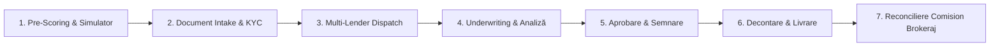

# 🔬 ARHITECTURĂ & SPECIFICAȚIE: PORTOFOLIU MANAGEMENT LEADURI & DOSARE CREDIT AUTO (F&I)
> **Data & Ora:** 2026-10-24 21:28:00  
> **Sursă Grounding:** NotebookLM Master Brain (`[CARVANA] RXM Automobile Showroom Brain` • `86c800a6-9429-46c4-a9a9-894d205df501`)  
> **Target:** ParcOS / RXM Automobile (Carvana Dealer OS) — Modul Financiar F&I (Finance & Insurance)

---

## 🧭 1. REZUMAT EXECUTIV & DE CE ESTE CRUCIAL PENTRU UN PARC AUTO

Pe piața auto din România (atât pentru mașini rulate cât și noi), **65% - 75% din vânzări se realizează prin finanțare** (Credit de Nevoi Personale Auto, Credit Auto cu Garanție sau Leasing Financiar/Operativ).

În prezent, majoritatea parcurilor independente gestionează dosarele de credit în mod haotic:
- Pe foi volante, WhatsApp, tabele Excel sau direct în portalul fiecărui finanțator (TBI Bank, BT Direct, UniCredit, Mogo).
- Nu există trasabilitate a stadiului în care se află dosarul la bancă (Dacă banca a cerut adeverință suplimentară, dacă s-a aprobat cu avans, dacă au intrat banii în cont).
- Vânzătorii riscă să vândă mașina unui alt client cash în timp ce dosarul de credit este aprobat în proporție de 90%, sau invers — blochează mașina săptămâni întregi pentru un client respins de Biroul de Credit.
- Dealerul pierde evidența **comisioanelor de brokeraj financiar** (kickback bancar de 1% – 3.5% din suma finanțată), care reprezintă adesea 500 – 2.000 RON profit curat per tranzacție, pe lângă marja mașinii.

---

## 🔄 2. CELE 7 ETAPE OPERAȚIONALE ALE PIPELINE-ULUI DE CREDIT (F&I Sub-Pipeline)

Un dosar de credit are un ciclu de viață specific, distinct de un lead obișnuit de vânzare:



1. **Pre-Scoring & Simulator Financiar (Eligibility Check):**
   - Calcul instant rată lunară în funcție de preț vehicul, avans (0% - 50%) și perioadă (12 - 60 luni).
   - Verificare criterii minime de eligibilitate: contract de muncă (min. 3 luni la actualul angajator), venituri în România sau Diaspora (contract extern + extrase), pensionari.
2. **Document Intake (Colectare & Validare KYC):**
   - Scanare CI (Carte de Identitate) prin modulul OCR.
   - Generare și semnare Acord Interogare ANAF & Biroul de Credit (semnătură electronică OTP/SMS).
   - Documente speciale dacă e cazul: contract de muncă diaspora, decizie pensie, date co-plătitor/girant.
3. **Multi-Lender Dispatch (Dispecerizare către Finanțatori):**
   - Trimitere cerere către partenerul optim:
     - **TBI Bank:** Aprobare 100% online în 15-30 minute.
     - **BT Direct / Banca Transilvania:** Dobânzi preferențiale pentru clienți cu scoring bun.
     - **UniCredit Consumer Financing:** Finanțare sume mari / autoturisme premium.
     - **Mogo / Claret:** Soluție de recuperare pentru clienți cu istoric negativ în Biroul de Credit.
4. **Underwriting & Analiză Risc (Decizie Finanțator):**
   - `under_review`: Dosarul este analizat de ofițerul de risc bancar.
   - `conditional`: Aprobat cu condiții (ex: necesar avans de 15% sau co-plătitor).
   - `rejected`: Respins (cu motiv salvat: grad de îndatorare > 40%, istoric negativ, venit insuficient).
5. **Aprobare Finală & Semnare Contract Credit (Approved & Signed):**
   - Primire contract oficial de credit și scadențar de rate.
   - Semnare fizică în showroom sau electronică prin SMS/OTP.
   - Mașina se blochează automat ca `reserved` în stocul ParcOS.
6. **Decontare & Livrare (Funded & Handed Over):**
   - Banca virează valoarea finanțată direct în contul dealerului (Banca Transilvania).
   - Generare factură fiscală / contract vânzare cu mențiunea „Achitat prin Credit Bancar TBI/BT”.
   - Mașina trece în starea `sold` și se livrează clientului.
7. **Reconciliere Comision Brokeraj Dealer (Dealer Brokerage Tracking):**
   - Înregistrare comision brokeraj (ex: 2.0% din suma creditată = 1.400 RON).
   - Urmărire facturare și încasare comision de la banca finanțatoare.

---

## 🗄️ 3. SCHEMA DE DATE & ENTITĂȚI TYPESCRIPT RECOMANDATE

```typescript
export type CreditorPartnerId = 'tbi' | 'bt' | 'unicredit' | 'creditfix' | 'mogo' | 'other';

export type FinancingDossierStatus = 
  | 'draft'               // Date inițiale, necompletat
  | 'docs_pending'        // Așteaptă CI / Acord ANAF de la client
  | 'submitted'           // Trimis la finanțator
  | 'under_review'        // În analiză la bancă
  | 'conditional'         // Aprobat condiționat (ex: avans suplimentar)
  | 'approved'            // Aprobat definitiv
  | 'contract_signed'     // Contract credit semnat
  | 'funded'              // Banii au fost virați în contul parcului
  | 'delivered'           // Mașină predată clientului
  | 'rejected'            // Respins de bancă
  | 'canceled';           // Clientul a renunțat

export interface FinancingDossierItem {
  id: string;
  leadId?: string;               // Referință la DealerLeadItem
  carId: string;                 // Referință la vehiculul din stoc
  carTitle: string;
  carPriceEur: number;
  carPriceRon: number;
  
  // Date Solicitant (Borrower)
  clientName: string;
  clientPhone: string;
  clientEmail?: string;
  clientCnp?: string;
  clientEmploymentType: 'salariat_ro' | 'salariat_diaspora' | 'pensionar' | 'pfa_srl' | 'co_platitor';
  monthlyNetIncomeRon?: number;
  existingDebtsRon?: number;
  
  // Date Finanțare
  creditor: CreditorPartnerId;
  downPaymentEur: number;
  downPaymentRon: number;
  downPaymentPct: number;         // ex: 0, 10, 20
  financedAmountRon: number;      // Valoarea creditată
  tenureMonths: number;           // 12, 24, 36, 48, 60
  interestRatePct: number;        // ex: 7.9%
  monthlyInstallmentRon: number;  // Rata estimată
  
  // Status & Workflow
  status: FinancingDossierStatus;
  rejectionReason?: string;
  conditionNotes?: string;
  
  // Checklist Documente
  documents: {
    idCardUploaded: boolean;
    anafConsentSigned: boolean;
    incomeProofUploaded: boolean;
    bankContractUploaded: boolean;
  };
  
  // Monetizare & Comision Dealer
  brokerCommissionPct?: number;     // ex: 2.0%
  brokerCommissionRon?: number;     // ex: 1.200 RON
  commissionPayoutStatus: 'pending' | 'invoiced' | 'collected';
  
  // Audit & Responsabil
  assignedOfficer: string;          // ex: "Mădălina - Finanțare"
  internalNotes?: string;
  createdAt: string;
  updatedAt: string;
}
```

---

## 🖥️ 4. INTEGRARE VIZUALĂ ÎN PARCOS

1. **Sub-Modul în ParcOsSidebar:**
   - Adăugare buton dedicat în meniul lateral: **„Dosare Finanțare (F&I)”** cu badge activ pentru dosarele ce necesită acțiune (ex: documente lipsă sau aprobate ce așteaptă viramentul).
2. **Vedere Dublă: Kanban Finanțare & Tabel Portofoliu:**
   - **Kanban:** Coloane pe stadii operative (*Documente Lipsă ➔ În Analiză Bancă ➔ Aprobat ➔ Decontat / Livrat ➔ Respins*).
   - **Tabel Portofoliu:** Căutare rapidă după client, mașină, finanțator (TBI / BT) și total volum finanțat (KPIs: Rata de aprobare %, Volum total finanțat luna curentă, Comisioane de încasat).
3. **Corelare Automată cu Stocul Auto:**
   - Când dosarul este aprobat final ➔ mașina devine automat **„Rezervată”** în showroom.
   - Când dosarul este decontat (`funded`) ➔ mașina devine automat **„Vândută”**.
   - Dacă dosarul este respins sau anulat ➔ mașina redevine automat **„În Stoc”**.
