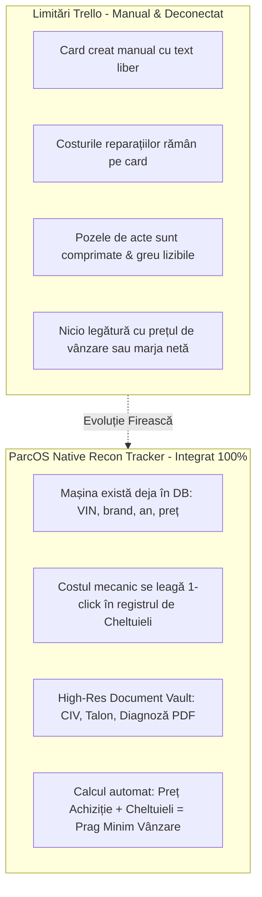

# 🔬 RAPORT CERCETARE & SPECIFICAȚIE ARHITECTURALĂ: VEHICLE RECON & SERVICE TRACKER + HIGH-RES DOCUMENT VAULT (PARCOS 2026)
> **Data & Ora:** 2026-10-26 01:40:00  
> **Sursă Grounding:** NotebookLM Master Brain (`[CARVANA] RXM Automobile Showroom Brain` • `86c800a6-9429-46c4-a9a9-894d205df501`)  
> **Target:** Gestiune Operațională Parc Auto (MPI Mureș / RXM Automobile / Chiriași ParcOS)  
> **Holding:** CARVANA SRL

---

## 🧭 1. REZUMAT EXECUTIV: DE CE TRELLO ESTE ABANDONAT ȘI CE FOLOSEȘTE INDUSTRIA?

În dealership-urile de mașini rulate, tranziția unui autoturism de la descărcarea de pe platformă până la expunerea cu etichetă de preț în showroom se numește **Reconditioning Workflow (Recon Pipeline)** sau *Time to Front-Line Ready (T2FLR)*.

Până în prezent, la parcul **MPI**, gestionarea stocului și a intervențiilor se făcea manual prin **Trello**. Deși Trello oferă o vizualizare Kanban plăcută vizual, el creează 4 blocaje critice:

---

## 📊 2. BENCHMARK COMPETITIV: CUM REZOLVĂ PIAȚA MONDIALĂ ȘI LOCALĂ

### 🥇 A. Standardul din SUA: RapidRecon (vAuto / Cox Automotive)
* **Concept cheie:** *Holding Cost Calculator*. Fiecare zi în care o mașină stă la mecanic fără a fi expusă la vânzare costă parcul auto în medie **35 € - 45 € / zi** (dobândă capital imobilizat, depreciere piață, cost de oportunitate).
* **Soluție:** Un Kanban simplificat împărțit pe pași (Check-in ➔ Mecanică ➔ Detailing ➔ Poze ➔ Gata). Fiecare mașină are un contor de zile: dacă depășește 5 zile în pregătire, se colorează în roșu.

### 🥈 B. Piața din România: Carmatik & DealerOS vs. Realitatea din Parcuri
* **Carmatik.ro:** Oferă module de facturare, contracte și asistentul AI Matik, dar **nu are un tracker vizual de service** dedicat mecanicilor. Dealerii sunt forțați să folosească grupuri de WhatsApp sau caiete de service.
* **DealerOS:** Are tablou de bord pentru alerte de ITP/RCA, dar lipsește complet fluxul de reparații și verificări tehnice.
* **Mecanicii din parcuri:** Refuză softurile complicate de contabilitate cu 30 de câmpuri obligatorii. Ei au nevoie de o interfață cu **bife mari (touch-friendly pe telefon)**, poze rapide și costul pieselor.

---

## 🛠️ 3. DE CE PARCOS ARE AVANTAJUL SUPREM: DATELE SUNT DEJA CENTRALIZATE!

ParcOS dispune deja în cod de toate componentele necesare, ceea ce face implementarea extrem de curată, fără a aglomera baza de date:

1. **Registrul de Cheltuieli Existent (`VehicleExpenseItem` în `src/db/types.ts`):**
   * Există deja categoriile: `mechanical_repairs`, `detailing_cleaning`, `bodywork_paint`, `parts`, `rar_registration`, `purchase_transport`.
   * În modulul existent `DetailExpensesTab.tsx`, dealerul introduce deja cheltuielile.
   * **Inovația Tracker-ului:** Când mecanicul bifează „Schimbat distribuție (400 €)”, cheltuiala se inserează automat în registrul financiar al mașinii!
2. **Date de Identificare & Alerte Flotă:**
   * Câmpurile `vin`, `hasRedPlates`, `redPlatesExpiresAt`, `itpExpiresAt`, `rarAppointmentDate` sunt deja salvate pe vehicul.
3. **Jurnal de Audit (`auditLog`):**
   * Orice mutare de coloană (ex: din *„În Service”* în *„Detailing”*) generează automat un log de audit cu autor și oră.

---

## 🎨 4. CELE 5 COLOANE CANONICE PENTRU MPI (FĂRĂ AGLOMERAȚIE)

Pentru a menține ecranul aerisit și extrem de eficient:

| # | Coloană Kanban | Descriere Operațională | Indicator Card |
|---|---|---|---|
| **1** | **📥 Preluare & Diagnoză** | Mașina a sosit pe platformă. Se face inspecția inițială, se notează defectele vizuale și se scanează actele. | Badge: *X defecte notate* |
| **2** | **🔧 Mecanică & Piese** | Mașina este la elevator / service. Se așteaptă piese sau se lucrează la mecanică/electrică. | Badge: *Cost Piese: X €* |
| **3** | **🎨 Tinichigerie & Detailing** | Reparații estetice, polish caroserie, curățare chimică interior, detailing motor. | Badge: *În Detailing* |
| **4** | **📑 RAR, ITP & Acte** | Pregătire dosar înmatriculare, programare RAR, obținere CIV sau prelungire numere roșii. | Badge: *Data RAR / Expirare* |
| **5** | **✨ Gata de Vânzare** | Mașina este curată, fotografiată și expusă în showroom-ul public la prețul final. | Badge: *Gata de Showroom* |

---

## 📑 5. HIGH-RES TECHNICAL DOCUMENT VAULT (CIV, TALON, FACTURI, DIAGNOZE)

### Problema Calității:
În showroom-ul public, imaginile sunt optimizate în WebP (480px, 960px, 1600px) pentru a se încărca în sub 0.5 secunde pe telefoanele cumpărătorilor.
Documentele tehnice au însă nevoie de **claritate 100% (rezoluție 4K / PDF vectorial)**, astfel încât:
* Mecanicul să poată citi seria de motor, codul de vopsea și dimensiunile anvelopelor din CIV.
* Băiatul de la birou să poată verifica seria de șasiu și ștampila fiscală din talonul străin (Brief mare / Brief mic / Carte Germania).

### Arhitectură Document Vault:
* Stocare în **Cloudflare R2 Vault** (sau Google Drive Holding Vault).
* Păstrare fișier original fără compresie agresivă (`.pdf`, `.png`, `.jpg` de 300 DPI).
* Viewer dedicat în interfață cu:
  * Zoom optic continuu (100% ➔ 400%) cu pan (tragere cu mouse-ul/touch).
  * Buton de rotire 90° (esențial pentru CIV-urile fotografiate strâmb).
  * Descărcare directă sau print 1-click.
  * Mascare automată a datelor personale ale fostului proprietar (conform GDPR).

---

## 🧭 6. STRUCTURA INTERFEȚEI ÎN SIDEBAR (`ParcOsSidebar.tsx`)

* **Grup:** `OPERAȚIUNI STOC`
* **Nav Item:**
  * **ID:** `'recon_tracker'`
  * **Icon:** `Wrench` (Lucide React)
  * **Label:** `Service & Pregătire`
  * **Badge:** `3 în lucru` (culoare chihlimbar: `bg-amber-500/15 text-amber-300 border-amber-500/30`)
* **Comutator de vedere (HUD superior):**
  * 📋 **Vedere Board (Kanban):** Pentru gestionare vizuală zilnică și drag & drop rapid.
  * 📊 **Vedere Tabel / Costuri:** Pentru patron/manager (vezi dintr-o privire cât s-a cheltuit pe fiecare mașină și unde sunt blocaje).
  * 🗄️ **Seif Documente:** Filtru rapid pentru a găsi CIV-ul sau talonul oricărei mașini în 2 secunde.

---

## ⚖️ 7. CONFORMITATE CU INVARIANTELE CARVANA SRL
1. **Strict 21% TVA:** Orice piesă sau manoperă introdusă calculează automat TVA deductibil 21% (`VAT_RATE = 0.21`).
2. **Garanție:** Termenul utilizat în contractele de rezervare pentru mașinile aflate încă în service este strict **„Garanție de Rezervare”** (niciodată escrow).
3. **Dark Luxury Dual-Theme:** Design-ul board-ului utilizează tokeni Tailwind adaptivi (`bg-zinc-900/60`, `border-zinc-800`, `text-zinc-200`) garantând contrast WCAG AA.
